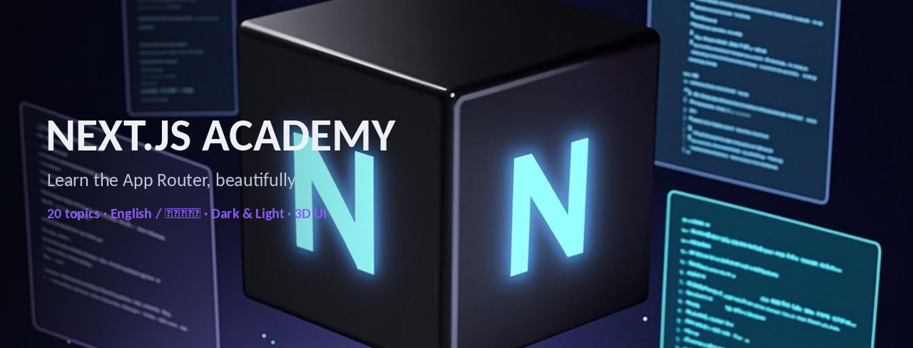

<div align="center">



# 🎓 Next.js Academy

**Learn the App Router, beautifully — یک تجربه‌ی لوکس و دوزبانه برای یادگیری نکست‌جی‌اس**


**🌐 Live site:** <https://amiralisite.github.io/nextjs-academy/>

</div>

---

## ✨ What is this?

A complete, **luxurious, bilingual (English / فارسی)** interactive documentation & learning platform for the **Next.js 15 App Router**, built with Next.js itself and deployed as a fully static site on GitHub Pages.

### Highlights

| | |
|---|---|
| 🧭 **20 deep-dive topics** | Foundations → Routing → Rendering & Data → Production, each with real, copy-ready code |
| 🌍 **Two languages, one click** | English ⇄ فارسی with instant RTL flip, language-specific fonts (Vazirmatn), preference persisted |
| 🌗 **Night & day themes** | Hand-tuned dark/light tokens, glass surfaces, aurora background, buttery transitions |
| 🧊 **3D & motion** | Rotating CSS 3D cube, pointer-tracked tilt cards, particle network canvas, scroll reveals |
| ⏳ **Loading as a feature** | Cinematic preloader, route progress bar, orbit-spinner `loading.tsx` states, skeletons |
| 📱 **Fully responsive** | Mobile drawer nav, fluid `clamp()` typography, collapsing layouts — designed phone-first |
| ⚡ **100% static** | `output: "export"` — pure HTML/CSS/JS on a global CDN, zero server cost |

### Tech stack

- **Next.js 15.5** (App Router, Server Components, `output: "export"`)
- **React 19** + **TypeScript 5** (strict)
- **Custom CSS design system** — no UI libraries, tokens in `app/globals.css`
- **next/font** — Space Grotesk · Vazirmatn · JetBrains Mono (zero layout shift)
- **GitHub Pages** — `gh-pages` branch + `.nojekyll`, `basePath: /nextjs-academy`

## 🧭 Curriculum

| Part | Topics |
|---|---|
| **01 — Foundations** | Introduction · Installation & Setup · Project Structure |
| **02 — Routing & Navigation** | The App Router · Routing & Dynamic Segments · Linking & Navigating |
| **03 — Rendering & Data** | Server & Client Components · Rendering Patterns · Data Fetching · Caching in Depth · Server Actions · Streaming & Suspense |
| **04 — Production & Polish** | Images & Fonts · Metadata & SEO · Styling · Route Handlers · Env Variables · i18n · Performance · Deployment |

Every topic ships with code samples, bullet summaries, reading time, prev/next navigation and a sticky sidebar.

## 📂 Project structure

```
nextjs-academy/
├── app/
│   ├── layout.tsx            # fonts, metadata, providers, boot script
│   ├── page.tsx              # home (hero, features, curriculum, roadmap)
│   ├── globals.css           # design tokens, chrome
│   ├── fx.css                # 3D, loaders, animations
│   ├── docs.css              # docs UI, code blocks
│   ├── icon.svg              # favicon
│   ├── not-found.tsx         # bilingual 404
│   └── docs/
│       ├── page.tsx          # curriculum index + search
│       ├── loading.tsx       # orbit loader
│       └── [slug]/page.tsx   # topic pages (static params)
├── components/               # Providers, Navbar, Hero, CodeBlock, …
├── content/topics/           # 20 bilingual lessons (TS data)
├── lib/                      # types, i18n dictionary, topic registry
├── public/                   # og image
└── deploy/github-pages.yml.example   # optional Actions workflow (see below)
```

## 🚀 Run locally

```bash
git clone https://github.com/amiraliSite/nextjs-academy.git
cd nextjs-academy
npm install
npm run dev        # http://localhost:3000
```

```bash
npm run build      # static export → out/  (production: basePath /nextjs-academy)
```

## ☁️ How it is deployed

**Current method — `gh-pages` branch (works with any token, no Actions needed):**

1. `npm run build` produces the static export in `out/`.
2. `out/` is committed to the `gh-pages` branch, including a `.nojekyll` file so GitHub serves the `_next/` folder.
3. Repository **Settings → Pages** is set to *Deploy from branch: `gh-pages`, root*.

**Optional — GitHub Actions automation:** the token used to create this repository only has the `repo` scope, so a workflow file could not be pushed. A ready-made workflow is included at [`deploy/github-pages.yml.example`](deploy/github-pages.yml.example). If your token has the `workflow` scope, move it to `.github/workflows/deploy.yml`, push, and enable *Settings → Pages → Build and deployment → Source: GitHub Actions* — every push to `main` will then build and deploy automatically.

---

<div align="center">

## 🇮🇷 فارسی — درباره‌ی پروژه

**آکادمی نکست‌جی‌اس** یک پلتفرم آموزشی و مستندسازیِ کاملاً دوزبانه (انگلیسی / فارسی) برای **اپ روتر نکست‌جی‌اس ۱۵** است که با خودِ نکست‌جی‌اس ساخته شده و به‌صورت کاملاً استاتیک روی GitHub Pages منتشر می‌شود.

- **۲۰ سرفصل عمیق** در ۴ بخش: مبانی، مسیریابی و ناوبری، رندر و داده، تولید و پالایش — همراه با نمونه‌کد آماده‌ی کپی
- **دو زبان با یک کلیک** — سوییچ لحظه‌ای انگلیسی ⇄ فارسی، چرخش خودکار رابط به RTL و فونت وزیرمتن
- **حالت شب و روز** با توکن‌های دست‌ساز، سطوح شیشه‌ای و ترنزیشن‌های لطیف
- **گرافیک سه‌بعدی و موشن** — مکعب CSS سه‌بعدی در حال چرخش، کارت‌های تیلت با حرکت موس، شبکه‌ی ذرات، انیمیشن اسکرول
- **لودینگ‌های خفن** — پری‌لودر سینمایی، نوار پیشرفت مسیر، اسپینر مداری و اسکلت‌های shimmer
- **کاملاً ریسپانسیو** — طراحی موبایل‌-محور با تایپوگرافی سیال `clamp()`

**سایت زنده:** <https://amiralisite.github.io/nextjs-academy/>

اجرای محلی:

```bash
git clone https://github.com/amiraliSite/nextjs-academy.git
cd nextjs-academy && npm install && npm run dev
```

روش استقرار فعلی: خروجی استاتیک (`output: "export"`) به برنچ `gh-pages` پوش می‌شود و Pages از همان برنچ سرو می‌کند. فایل [`deploy/github-pages.yml.example`](deploy/github-pages.yml.example) هم آماده است تا در صورت داشتن اسکوپ `workflow`، به مسیر `.github/workflows/deploy.yml` منتقل شده و دیپلوی خودکار انجام شود.

</div>

---

## 📄 License

MIT — free to learn from, fork and remix. Built with ❤️ by [amiraliSite](https://github.com/amiraliSite) & Z.ai agent.
